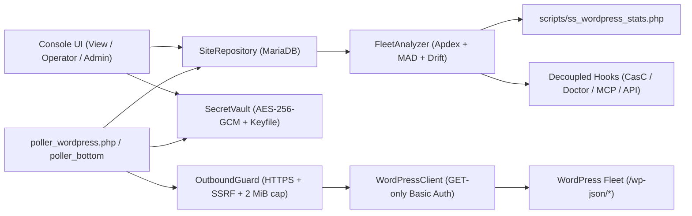

# plugin_wordpress

`plugin_wordpress` is a standalone Cacti 1.2 plugin for monitoring WordPress fleets through WordPress Application Passwords and strictly read-only REST, Site Health, and runtime telemetry endpoints. It requires zero Cacti core patches, zero Composer runtime dependencies, and zero cross-plugin PHP imports at boot.

## Why This Plugin Exists

Operating dozens or thousands of WordPress sites across business units creates blind spots that basic HTTP 200 checks miss: stalled WP-Cron queues, `wp_options` autoload bloat pushing every request over memory limits, unpatched plugin/theme drift, failing Site Health checks, and expiring TLS certificates. `plugin_wordpress` brings those signals into Cacti graphs, Thold alerts, and remote collectors while enforcing outbound SSRF protections and encrypted at-rest credential storage.

## Key Capabilities

- **Hardened Read-Only WordPress Client (`lib/Client/`, `lib/Security/`)**
  - Authenticates with HTTP Basic Auth (WordPress Application Passwords) and sends an explicit `User-Agent`; exposes GET-only transport with zero write methods.
  - Polls `/wp-json/` (core version, namespaces, XML-RPC and `/wp/v2/users` exposure checks), `/wp-json/wp-site-health/v1/tests/*` and `/directory-sizes`, `/wp-json/wp/v2/plugins`, `/wp-json/wp/v2/themes`, and an optional read-only runtime telemetry JSON payload (WP-Cron overdue count and oldest lag, `wp_options` autoload bytes and row count, Object Cache hit ratio, OPcache hit ratio and memory usage, PHP-FPM active/idle/queued workers, TLS days to expiry, TTFB/p95 ms, and HTTP 4xx/5xx error rate).
  - Enforces mandatory HTTPS, TLS peer/host verification by default, private/link-local/cloud-metadata IP SSRF blocking with configurable internal host/CIDR allowlists, DNS IP pinning (`CURLOPT_RESOLVE`), zero HTTP redirects, bounded connect/read timeouts, and a hard 2 MiB response byte cap.
- **Local AES-256-GCM Credential Vault (`lib/Security/SecretVault.php`)**
  - Encrypts WordPress Application Passwords at rest using AES-256-GCM with an external 256-bit keyfile (`wordpress_vault_key_file`, enforced non-world-readable) and per-site Authenticated Additional Data (`wordpress:site:<slug>`).
  - Stores ciphertexts in local-only `plugin_wordpress_secrets`; never replicates secrets to remote pollers and never exports them in CasC, Doctor, MCP, API, CLI output, or logs.
- **Fleet Analytics, Adaptive Sizing, and Thold Templates (`lib/Metrics/`)**
  - Computes fleet and per-site Apdex scores, Median Absolute Deviation (MAD) TTFB latency anomaly detection, `wp_options` autoload bloat severity (`> 800 KiB` warn, `> 2 MiB` critical), WP-Cron stall alerts, TLS expiry countdowns, core/plugin/theme update drift, and Cacti Thold baseline threshold definitions.
  - Sizes collector concurrency dynamically using Little's Law ($L = \lambda \cdot W$) combined with CoDel standing-delay backoff, plus deterministic `--shard=K/N` partitioning across remote collectors.
- **Three-Tier RBAC Console UI, Poller, Script Server, and CLI**
  - `wordpress_view.php` (**WordPress View**): read-only fleet metrics, Apdex, MAD anomalies, and Thold templates.
  - `wordpress_operator.php` (**WordPress Operator**): drift, Site Health, WP-Cron, autoload inspection, and CSRF-protected read-only dry-run probes.
  - `wordpress_admin.php` (**WordPress Admin**): site inventory CRUD, write-only vault credential updates, and poller assignment with CSRF protection.
  - `poller_wordpress.php` and `poller_bottom`: supports `--poller=N`, `--shard=K/N`, `--site=<slug>`, and `--dry-run`, with `INFO` `remote_collect:1` and `replicate_out` syncing non-secret `plugin_wordpress_sites` rows only.
  - `scripts/ss_wordpress_stats.php`: PHP 8.0-parseable Cacti script-server output emitting `sites_total`, `sites_healthy`, `sites_degraded`, `sites_critical`, `updates_pending`, `cron_overdue_total`, `autoload_bloat_sites`, `ttfb_p95_ms`, and `tls_min_expiry_days` with `U` fallback on error.
  - `cli/wordpress.php`: `export --format=yaml|xml`, `validate`, `plan`, `apply --confirm=<PLAN_HASH>`, `health --format=text|json`, and `probe --site=<slug>`.

## Architecture



## Security Boundaries

- **Transport and SSRF**: `OutboundGuard` rejects non-HTTPS schemes, embedded URL credentials, control characters, HTTP 3xx redirects, and responses larger than 2 MiB. Resolved IPv4 and IPv6 addresses are checked against RFC 1918, loopback, link-local, CGNAT, multicast, reserved, and IPv4-mapped IPv6 ranges; cloud instance metadata endpoints (`169.254.169.254`, `169.254.170.2`, `fd00:ec2::/32`) are unconditionally blocked even when an enterprise allowlist is configured.
- **Secret Isolation**: Application Passwords are stored exclusively in `plugin_wordpress_secrets` encrypted with AES-256-GCM using an external 256-bit keyfile. `wordpress_replicate_out` replicates only `plugin_wordpress_sites`. Declarative Config exports represent credentials solely as symbolic `vault:wordpress:<slug>` references.
- **RBAC and CSRF**: Console access enforces three Cacti realms (`WordPress Admin` > `WordPress Operator` > `WordPress View`). Operator and Admin POST forms verify a 256-bit synchronizer token (`CsrfGuard`) in constant time in addition to Cacti's built-in CSRF protection. MCP ability permission checks query Cacti's `user_auth_realm` and `user_auth_group_realm` tables by user ID rather than `$_SESSION`.

## Installation and Quick Start

1. Place this repository at `<cacti_root>/plugins/wordpress`.
2. Install and enable the plugin through Cacti CLI or Console -> Configuration -> Plugin Management:
   ```bash
   php cli/plugin_manage.php --plugin=wordpress --install --enable
   ```
3. Generate a 256-bit vault keyfile outside the web root with strict permissions:
   ```bash
   openssl rand -hex 32 > /etc/cacti/wordpress-vault.key
   chmod 0600 /etc/cacti/wordpress-vault.key
   chown www-data:www-data /etc/cacti/wordpress-vault.key
   ```
4. Set `wordpress_vault_key_file` to `/etc/cacti/wordpress-vault.key` under Console -> Configuration -> Settings -> WordPress.
5. Add WordPress sites in Console -> Utilities -> WordPress Inventory & Vault (or via `cli/wordpress.php apply --confirm=<PLAN_HASH>`).

## CLI Examples

```bash
# Export declarative Config-only YAML (credentials appear only as vault:wordpress:<slug>)
php plugins/wordpress/cli/wordpress.php export --format=yaml > fleet.yaml

# Validate and generate a deterministic SHA-256 plan hash
php plugins/wordpress/cli/wordpress.php validate --file=fleet.yaml
php plugins/wordpress/cli/wordpress.php plan --file=fleet.yaml

# Apply changes using the printed PLAN_HASH
php plugins/wordpress/cli/wordpress.php apply --file=fleet.yaml --confirm=<PLAN_HASH>

# Inspect fleet health or run a single-site read-only probe
php plugins/wordpress/cli/wordpress.php health --format=json
php plugins/wordpress/cli/wordpress.php probe --site=flagship-wp --format=json

# Run a sharded remote collector pass
php plugins/wordpress/poller_wordpress.php --poller=2 --shard=1/4 --format=json

# Query Cacti script server output directly
php plugins/wordpress/scripts/ss_wordpress_stats.php 1
```

## Decoupled Ecosystem Hooks

All ecosystem hooks return plain arrays or interact with duck-typed registrars with zero cross-plugin PHP imports at boot:

| Hook | Registration | Purpose |
| --- | --- | --- |
| `casc_register_providers` | `slug: wordpress` | Config-only export, validation, plan, and hash-confirmed apply matching `schema/wordpress.schema.yaml`. |
| `doctor_register_checks` | 4 pre-evaluated checks | Vault keyfile health, fleet availability, WP-Cron/autoload bloat, and TLS expiry checks. |
| `doctor_register_debug_info` | `wordpress.overview` | Redacted operational telemetry (never exposes secrets or keyfile path). |
| `abilities_register` | `wordpress-list-sites`, `wordpress-get-health`, `wordpress-get-drift` | Read-only MCP abilities with bounded array schemas and DB-backed Cacti realm checks. |
| `api_register_resources` | `wordpressSites`, `wordpressHealth` | Read-only REST collection descriptors guarded by `wordpress_view.php` realm. |

## Requirements and Compatibility

- **Cacti**: `1.2.31+` and `1.2.x` (tested in CI against live MariaDB 11.8).
- **PHP**: `8.2+` runtime (`8.2`, `8.3`, `8.4`, `8.5` tested in CI); entry points (`setup.php`, `poller_wordpress.php`, `cli/wordpress.php`, `scripts/ss_wordpress_stats.php`, Console pages, `include/autoload.php`) remain PHP 8.0-parseable so older servers receive a clean refusal rather than a fatal parse error.
- **PHP Extensions**: `ext-json`, `ext-openssl`, `ext-curl` (live HTTPS probes), `ext-pdo`.

## Performance Profile

Benchmarked on PHP 8.4 at 5,000 and 10,000 WordPress sites; see [docs/architecture/performance-profile.md](docs/architecture/performance-profile.md) for methodology and full results (`FleetAnalyzer` completes 10,000 sites in 5.43 ms at 20 MiB peak RSS).

## Development and Testing

```bash
# Install dev-only tooling (PHPUnit 11.5, PHPStan 2.1)
composer install

# Run unit, security, and 100% AST PHPDoc + zero-import tests
composer test

# Run PHPStan Level 9 against Cacti release/1.2.31 stubs
CACTI_PATH=/path/to/cacti composer phpstan

# Run the 5,000 and 10,000 site performance benchmark
php scripts/benchmark.php
```

## License

GNU General Public License v2.0 or later (`GPL-2.0-or-later`). See [LICENSE](LICENSE) and [REUSE.toml](REUSE.toml).
